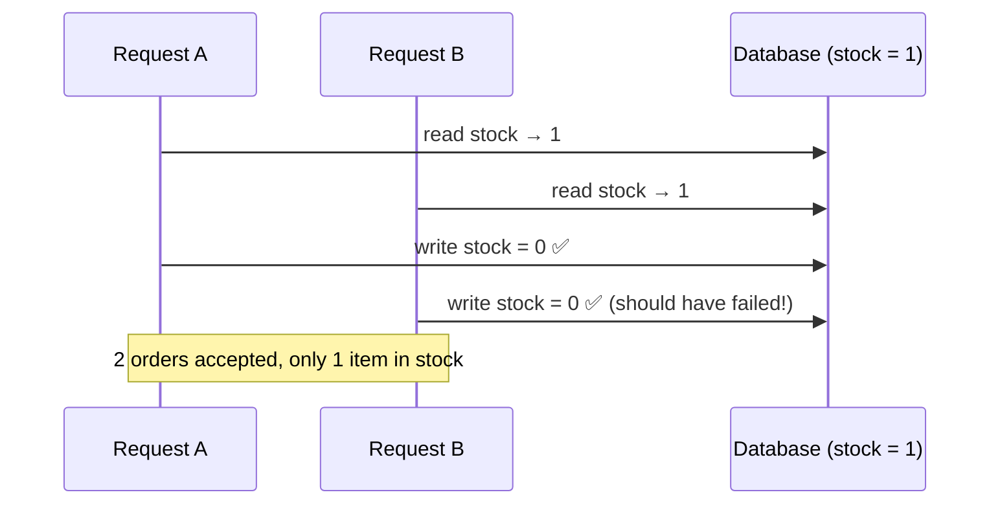
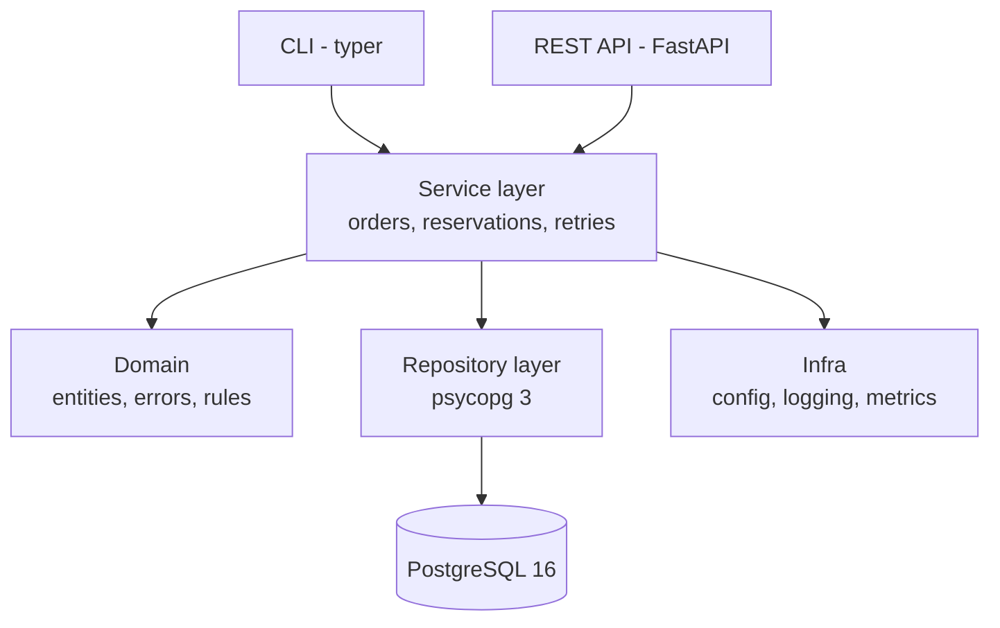
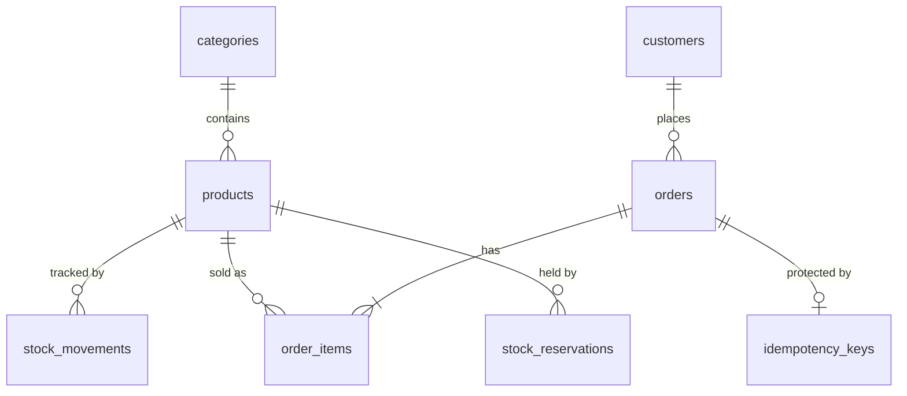

 <div align="center">

# 📦 SmartStock

### A transaction-safe inventory & order engine that never oversells.

*Module 01 of 06 — [OmniChain Enterprise Platform](../README.md)*


</div>

---

## 📑 Table of Contents

- [The Problem](#-the-problem)
- [The Solution](#-the-solution)
- [Proof: Benchmark Plan](#-proof-benchmark-plan)
- [Quickstart](#-quickstart)
- [Architecture](#-architecture)
- [Data Model](#-data-model)
- [API Overview](#-api-overview)
- [Project Structure](#-project-structure)
- [Roadmap](#-roadmap)
- [Engineering Principles](#-engineering-principles)
- [Engineering Foundations](#-engineering-foundations)
- [Contributing](#-contributing)
- [License](#-license)

---

## 🔥 The Problem

During high-traffic events (flash sales, Black Friday, limited drops), thousands of users press **"Place Order"** within the same second. A naive `read stock → check → write stock` flow lets many concurrent requests all see `stock = 1` and all succeed.

The result: **overselling**, forced cancellations, refunds, and lost customer trust.



## 🛡️ The Solution

SmartStock enforces correctness at **multiple independent layers**, so a bug in one layer cannot corrupt inventory.

| # | Layer | Mechanism | Guarantees |
|---|-------|-----------|------------|
| 1 | **Concurrency control** | Conditional atomic `UPDATE ... WHERE qty_stock >= :n RETURNING` *or* `SELECT ... FOR UPDATE` (swappable strategies) | No two requests can consume the same unit |
| 2 | **Storage invariant** | `CHECK (qty_stock >= 0)` | Negative stock is physically impossible, even with an application bug |
| 3 | **Idempotency** | `Idempotency-Key` header + `UNIQUE` key table | Retries and double-clicks never create duplicate orders |
| 4 | **Audit ledger** | Append-only `stock_movements` table | Every change is traceable; stock can be reconciled at any time |
| 5 | **Reservations** | Time-limited stock holds (`expires_at`) | Abandoned carts never lock stock forever |

> **Source of truth:** PostgreSQL is the only authority on stock levels. The in-memory `dict`/`set` cache is used **only** for O(1) SKU lookup and static product metadata, never for stock decisions.

Additional safeguards: money is always `NUMERIC(12,2)` / `Decimal` (never `float`), all queries are parameterized, and row locks are acquired in a fixed order (`product_id` ascending) to prevent deadlocks, with retry and exponential backoff on `deadlock_detected` / `serialization_failure`.

## 📊 Proof: Benchmark Plan

> ⚠️ **Status: pending.** The numbers below are the acceptance targets, not yet measured results. This table will be replaced with real data when Phase 5 is complete.

**Scenario:** 5,000 concurrent order requests for a product with stock = 10.

| Strategy | Expected successes | Expected rejections | Final stock | Oversold? |
|----------|-------------------:|--------------------:|------------:|:---------:|
| No locking (control) | > 10 | < 4,990 | < 0 or inconsistent | ❌ Yes (proves the test is valid) |
| `SELECT ... FOR UPDATE` | 10 | 4,990 | 0 | ✅ No |
| Atomic conditional `UPDATE` | 10 | 4,990 | 0 | ✅ No |

Reproduce (after Phase 1):

```bash
make bench
```

## 🚀 Quickstart

> ⚠️ Commands below become available as phases are completed. See the [Roadmap](#-roadmap).

**Prerequisites:** Python 3.12, Docker, GNU Make

```bash
# 1. Clone
git clone https://github.com/<your-username>/OmniChain-FullStack-Roadmap.git
cd OmniChain-FullStack-Roadmap/01-SmartStock-CLI-DB

# 2. Configure environment (never commit .env)
cp .env.example .env
chmod 600 .env

# 3. Start PostgreSQL 16 and apply migrations
make up
make migrate

# 4. Run tests (unit + integration + concurrency)
make test
```

**CLI usage (planned):**

```bash
smartstock add-product --sku KB-001 --name "Keyboard" --price 49.90 --stock 10
smartstock stock KB-001
smartstock order --customer 1 --item KB-001:2 --idempotency-key 7f3a...
smartstock report --from 2026-01-01 --to 2026-12-31
smartstock backup --out backups/
smartstock restore --file backups/2026-11-23.json
```

## 🏗️ Architecture

Clean / Hexagonal layering. **Dependencies point inward only.**



| Layer | Responsibility |
|-------|----------------|
| `domain` | `@dataclass(frozen=True)` entities, value objects, domain errors (`OutOfStockError`, `DuplicateRequestError`, `ReservationExpiredError`) |
| `repository` | SQL access only, no business rules |
| `service` | Transactions, concurrency strategies, idempotency, reservations |
| `api` / `cli` | Thin adapters that only call the service layer |
| `infra` | Settings (`.env`), structured JSON logging with `correlation_id`, Prometheus metrics |

## 🗄️ Data Model

Normalized to **3NF**. Schema changes happen **only through Alembic migrations**.



| Table | Key constraints |
|-------|-----------------|
| `categories` | `UNIQUE(name)` |
| `products` | `UNIQUE(sku)`, `CHECK(qty_stock >= 0)`, `CHECK(price >= 0)`, `version` column |
| `customers` | `UNIQUE(email)` |
| `orders` | status enum, `total NUMERIC(12,2)` |
| `order_items` | `CHECK(quantity > 0)`, price snapshot at purchase time |
| `stock_movements` | Append-only (UPDATE/DELETE blocked); type: `SALE`, `RETURN`, `ADJUST`, `RESERVE`, `RELEASE` |
| `stock_reservations` | `expires_at`, status: `ACTIVE` / `CONFIRMED` / `EXPIRED` |
| `idempotency_keys` | `UNIQUE(key)`, request hash, stored response |

**Reconciliation invariant:** `initial_stock + SUM(movements) = qty_stock` for every product.

## 🌐 API Overview

Base path: `/api/v1`. Interactive docs are auto-generated at `/docs` (OpenAPI).

| Method | Endpoint | Description |
|--------|----------|-------------|
| `GET` | `/products` | List products (pagination + filters) |
| `GET` | `/products/{sku}` | Product details |
| `POST` | `/orders` | Place order (**requires** `Idempotency-Key` header) |
| `POST` | `/reservations` | Reserve stock for a limited time |
| `GET` | `/sales/reports` | Sales analytics |
| `GET` | `/health` | Liveness / readiness |
| `GET` | `/metrics` | Prometheus metrics |

| Code | Meaning |
|------|---------|
| `201` | Order created (with `Location` header) |
| `404` | Product or resource not found |
| `409` | Insufficient stock / conflict |
| `422` | Invalid input or idempotency key reused with a different body |
| `429` | Rate limit exceeded |

Errors follow **RFC 7807** (`application/problem+json`). A Postman collection is provided in `postman/` and runs in CI via Newman.

## 📁 Project Structure

```text
01-SmartStock-CLI-DB/
├── src/smartstock/
│   ├── domain/
│   ├── repository/
│   ├── service/
│   ├── api/
│   └── infra/
├── migrations/              # Alembic
├── tests/
│   ├── unit/
│   ├── integration/
│   └── concurrency/
├── benchmarks/
├── docs/
│   ├── ARCHITECTURE.md
│   └── adr/                 # Architecture Decision Records
├── postman/
├── scripts/
├── .github/workflows/ci.yml
├── docker-compose.yml
├── Makefile
├── pyproject.toml
├── .env.example
└── README.md
```

## 🗺️ Roadmap

- [ ] **Phase 0 — Foundations:** repo hygiene, `pyproject.toml`, lint/type tools, `docker-compose`, `Makefile`
- [ ] **Phase 1 — Transaction core:** schema + Alembic, `FOR UPDATE` and atomic `UPDATE` strategies, deadlock retry, 5,000-request concurrency test, `EXPLAIN` analysis
- [ ] **Phase 2 — Safety features:** idempotency keys, append-only ledger, reservations with expiry job, reconciliation test
- [ ] **Phase 3 — Interfaces:** CLI (JSON backup/restore), FastAPI REST, auth, rate limiting, CORS, Postman collection
- [ ] **Phase 4 — Quality:** GitHub Actions CI, ≥ 90% coverage on domain/service, structured logs, Prometheus metrics, dependency and secret scanning
- [ ] **Phase 5 — Proof & docs:** benchmark report, ADRs, final documentation

## 📐 Engineering Principles

1. **PostgreSQL is the single source of truth** for stock.
2. **Money is never a float.** `NUMERIC(12,2)` in the database, `Decimal` in Python.
3. **All SQL is parameterized.** No string-built queries.
4. **No secrets in Git.** Configuration via environment variables; `.env` is `chmod 600` and git-ignored.
5. **Every claim is backed by a test or a reproducible benchmark.**
6. **Least privilege:** the application DB role cannot `DROP` or `ALTER`.

## 🧰 Engineering Foundations

The skills this module is designed to exercise, and where each is applied.

<details>
<summary><b>🟨 Linux, Shell & Environment</b></summary>

| Primitive | Application in SmartStock |
|-----------|---------------------------|
| `cd`, `ls`, `cp`, `mv`, `rm` | Managing the project tree, rotating JSON backups, cleaning `__pycache__` |
| `grep` and pipes `\|` | Log forensics, e.g. `grep "ROLLBACK" logs/audit.log \| wc -l` |
| `chmod` | `chmod 600 .env`, `chmod +x scripts/setup.sh` |
| Environment variables | `DB_HOST`, `DB_PASSWORD`, `API_SECRET` injected at runtime, never committed |

</details>

<details>
<summary><b>🟧 Git & GitHub Flow</b></summary>

| Primitive | Application in SmartStock |
|-----------|---------------------------|
| `init`, `add`, `commit` | Small atomic commits using Conventional Commits (`feat:`, `fix:`, `perf:`, `test:`) |
| `branch`, `merge` | Feature isolation, e.g. `feat/pg-row-lock`, `feat/http-gateway` |
| Conflict resolution | Reconciling concurrent schema/model changes while keeping tests green |
| Pull Request, `.gitignore` | Reviewed merges; excluding `venv/`, `.env`, `.pytest_cache/` |

</details>

<details>
<summary><b>🟦 Python Core</b></summary>

| Primitive | Application in SmartStock |
|-----------|---------------------------|
| Types & variables | Explicit annotations; `Decimal` for all currency |
| `if` / `for` / `while` | Stock validation, cursor streaming, interactive CLI loop |
| Functions | Small, pure, unit-testable (pricing, discounts, query builders) |
| `list`, `dict`, `set` | O(1) SKU lookup via `dict[str, Product]`, tag deduplication via `set` |

</details>

<details>
<summary><b>🟪 Practical Python</b></summary>

| Primitive | Application in SmartStock |
|-----------|---------------------------|
| File & JSON | Backup/restore with schema validation before import |
| Exceptions | `OutOfStockError`, `DuplicateSKUError`, `DatabaseConnectionError` mapped to HTTP codes |
| OOP & `@dataclass` | `Product`, `Customer`, `Order`, `OrderLine` as typed domain objects |
| `venv`, `pip`, `pytest` | Isolated environment, fixtures, concurrency and rollback tests |

</details>

<details>
<summary><b>🩵 SQL & PostgreSQL</b></summary>

| Primitive | Application in SmartStock |
|-----------|---------------------------|
| `SELECT` / `WHERE` | Low-stock queries, date-range order filters |
| `JOIN` / `GROUP BY` | Revenue by category, top products |
| Constraints & indexes | `CHECK`, `UNIQUE`, FKs, B-Tree and composite indexes |
| Transactions & `EXPLAIN` | `FOR UPDATE`, isolation levels, `EXPLAIN (ANALYZE, BUFFERS)` |

</details>

<details>
<summary><b>🩷 HTTP & REST</b></summary>

| Primitive | Application in SmartStock |
|-----------|---------------------------|
| Methods & status codes | `201` + `Location` on create, `409` on stock conflict |
| Headers | `Idempotency-Key`, `X-Request-ID` correlation, strict `Content-Type` |
| REST & CORS | Versioned resources, explicit origin allow-list (no `*`) |
| Postman | Executable collection covering happy path, validation errors, `409` |

</details>

## 🤝 Contributing

1. Create a branch: `git checkout -b feat/your-feature`
2. Commit using [Conventional Commits](https://www.conventionalcommits.org/)
3. Make sure `make lint` and `make test` pass
4. Open a Pull Request describing *what* changed and *why*

## 📄 License

Released under the [MIT License](LICENSE).

---

<div align="center">

**Part of the OmniChain Enterprise Platform** · Module 01 of 06

</div>
