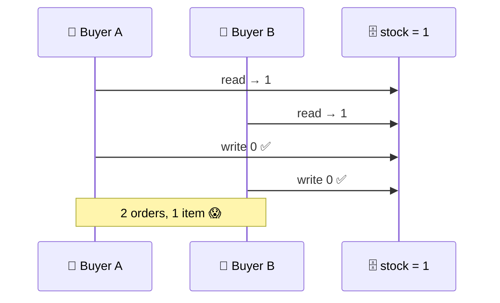
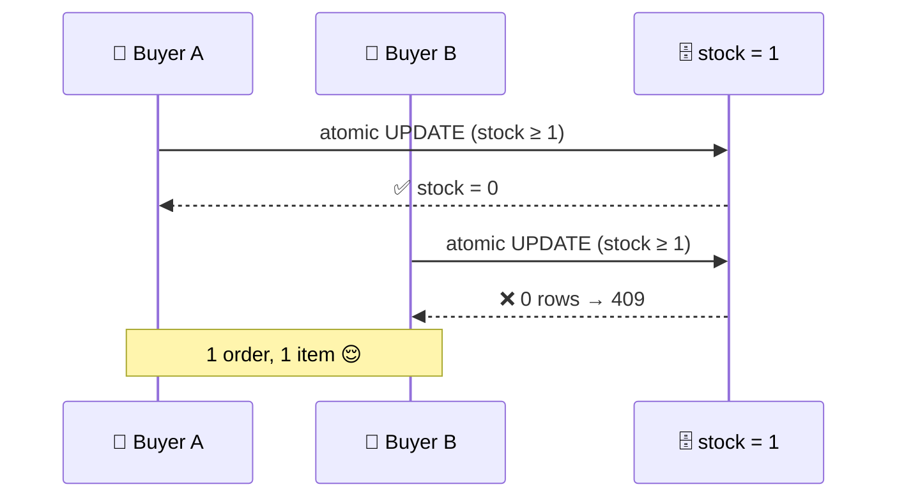
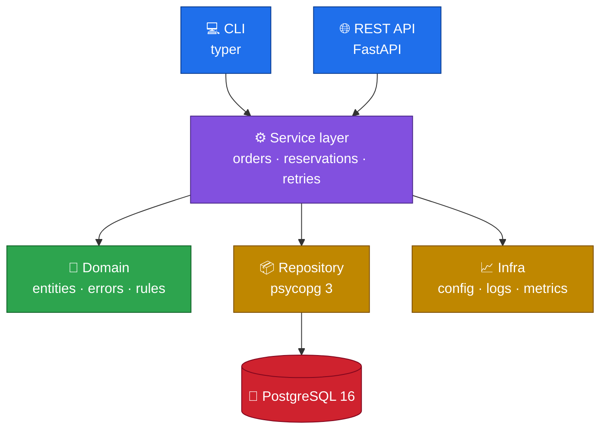
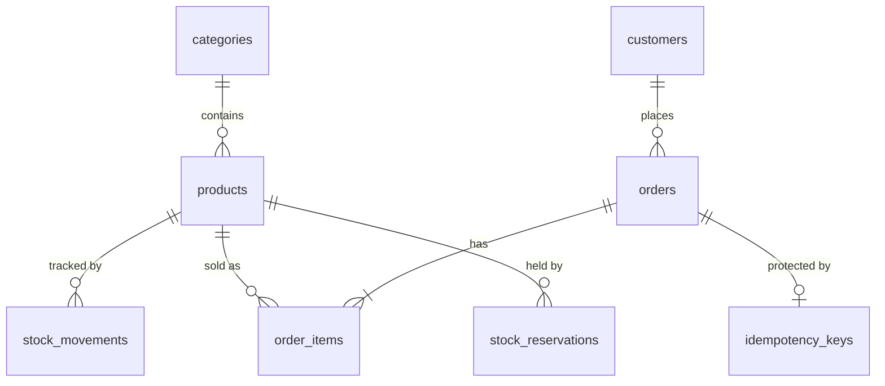

 <div align="center">


<a href="https://git.io/typing-svg">
  
</a>

<br/>


<br/>


<br/><br/>

**[The Problem](#-the-problem)** · **[The Solution](#-the-solution)** · **[Proof](#-proof-benchmark-plan)** · **[Quickstart](#-quickstart)** · **[Architecture](#-architecture)** · **[Roadmap](#-roadmap)**

</div>

---

> [!IMPORTANT]
> **🚧 Work in progress.** This module is under active development. Numbers marked as *target* are acceptance criteria, **not yet measured results**. They will be replaced with real, reproducible data when Phase 5 completes.

## 🔥 The Problem

It's Black Friday. **5,000 people** hit *"Place Order"* in the same second. **One item** is left.

A naive flow (`read stock → check → write stock`) lets every request see `stock = 1`, and **all of them succeed**.

<table>
<tr>
<td width="50%" valign="top">

### 💥 Naive approach



</td>
<td width="50%" valign="top">

### 🛡️ SmartStock



</td>
</tr>
</table>

**Consequences of overselling:** forced cancellations · refunds · angry customers · brand damage · financial loss.

## 🛡️ The Solution

SmartStock defends inventory with **five independent layers**. A bug in one layer cannot corrupt stock.

| | Layer | Mechanism | What it guarantees |
|:-:|-------|-----------|--------------------|
| 🔐 | **Concurrency control** | Atomic `UPDATE … WHERE qty_stock >= :n RETURNING` **or** `SELECT … FOR UPDATE` (swappable strategies) | No two requests can consume the same unit |
| 🧱 | **Storage invariant** | `CHECK (qty_stock >= 0)` | Negative stock is physically impossible |
| 🔁 | **Idempotency** | `Idempotency-Key` header + `UNIQUE` key table | Retries and double-clicks never duplicate an order |
| 📒 | **Audit ledger** | Append-only `stock_movements` | Every change is traceable and reconcilable |
| ⏳ | **Reservations** | Time-limited holds (`expires_at`) | Abandoned carts never lock stock forever |

> [!TIP]
> **Source of truth:** PostgreSQL alone decides stock levels. The in-memory `dict`/`set` cache is used **only** for O(1) SKU lookup and static metadata. It is never consulted for stock decisions.

<details>
<summary><b>🧪 Extra safeguards</b></summary>

- 💰 Money is `NUMERIC(12,2)` / `Decimal`, **never** `float`
- 🧷 All SQL is parameterized (no string-built queries)
- 🔢 Row locks acquired in fixed `product_id` order to prevent deadlocks
- 🔄 Retry with exponential backoff + jitter on `deadlock_detected` / `serialization_failure`
- 🔑 Least-privilege DB roles (the app role cannot `DROP` / `ALTER`)

</details>

## 📊 Proof: Benchmark Plan

> [!WARNING]
> **Status: pending.** Targets only. Real results arrive in Phase 5.

**Scenario:** 5,000 concurrent order requests · product stock = **10**

| Strategy | ✅ Successes | ❌ Rejections | 📦 Final stock | Oversold? |
|----------|:-----------:|:------------:|:-------------:|:---------:|
| 🔓 No locking *(control)* | > 10 | < 4,990 | inconsistent | 🔴 **Yes** (proves the test is valid) |
| 🔐 `SELECT … FOR UPDATE` | **10** | **4,990** | **0** | 🟢 No |
| ⚡ Atomic conditional `UPDATE` | **10** | **4,990** | **0** | 🟢 No |

```bash
make bench   # available after Phase 1
```

## 🚀 Quickstart

> [!NOTE]
> Commands become available as phases are completed. Track progress in the [Roadmap](#-roadmap).

**Prerequisites:** Python 3.12 · Docker · GNU Make

```bash
# 1️⃣ Clone
git clone https://github.com/<your-username>/OmniChain-FullStack-Roadmap.git
cd OmniChain-FullStack-Roadmap/01-SmartStock-CLI-DB

# 2️⃣ Configure (never commit .env)
cp .env.example .env && chmod 600 .env

# 3️⃣ Launch PostgreSQL 16 and apply migrations
make up && make migrate

# 4️⃣ Prove it works
make test
```

<details>
<summary><b>💻 Planned CLI</b></summary>

```bash
smartstock add-product --sku KB-001 --name "Keyboard" --price 49.90 --stock 10
smartstock stock KB-001
smartstock order --customer 1 --item KB-001:2 --idempotency-key 7f3a...
smartstock report --from 2026-01-01 --to 2026-12-31
smartstock backup  --out backups/
smartstock restore --file backups/2026-11-23.json
```

</details>

## 🏗️ Architecture

Clean / Hexagonal layering. **Dependencies point inward only.**



| Layer | Responsibility |
|:-----:|----------------|
| 🧠 `domain` | `@dataclass(frozen=True)` entities, value objects, errors (`OutOfStockError`, `DuplicateRequestError`, `ReservationExpiredError`) |
| 📦 `repository` | SQL access only, zero business rules |
| ⚙️ `service` | Transactions, locking strategies, idempotency, reservations |
| 🌐 `api` / 💻 `cli` | Thin adapters that call only the service layer |
| 📈 `infra` | `.env` settings, JSON logs with `correlation_id`, Prometheus metrics |

## 🗄️ Data Model

Normalized to **3NF**. Schema changes happen **only through Alembic migrations**.



| Table | Key constraints |
|-------|-----------------|
| `categories` | `UNIQUE(name)` |
| `products` | `UNIQUE(sku)` · `CHECK(qty_stock >= 0)` · `CHECK(price >= 0)` · `version` |
| `customers` | `UNIQUE(email)` |
| `orders` | status enum · `total NUMERIC(12,2)` |
| `order_items` | `CHECK(quantity > 0)` · price snapshot at purchase |
| `stock_movements` | **Append-only** · `SALE` `RETURN` `ADJUST` `RESERVE` `RELEASE` |
| `stock_reservations` | `expires_at` · `ACTIVE` / `CONFIRMED` / `EXPIRED` |
| `idempotency_keys` | `UNIQUE(key)` · request hash · stored response |

> [!NOTE]
> **Reconciliation invariant:** `initial_stock + SUM(movements) = qty_stock` for every product, verified by an automated test.

## 🌐 API Overview

Base path `/api/v1` · Interactive docs at `/docs` (OpenAPI)

| Method | Endpoint | Description |
|:------:|----------|-------------|
|  | `/products` | List products (pagination + filters) |
|  | `/products/{sku}` | Product details |
|  | `/orders` | Place order (**requires** `Idempotency-Key`) |
|  | `/reservations` | Reserve stock temporarily |
|  | `/sales/reports` | Sales analytics |
|  | `/health` · `/metrics` | Liveness · Prometheus |

| Code | Meaning |
|:----:|---------|
| 🟢 `201` | Order created (+ `Location` header) |
| 🟡 `404` | Resource not found |
| 🟠 `409` | Insufficient stock / conflict |
| 🟣 `422` | Invalid input, or idempotency key reused with a different body |
| 🔴 `429` | Rate limit exceeded |

Errors follow **RFC 7807** (`application/problem+json`). A Postman collection lives in `postman/` and runs in CI via Newman.

## 📁 Project Structure

```text
01-SmartStock-CLI-DB/
├── 📂 src/smartstock/
│   ├── 🧠 domain/
│   ├── 📦 repository/
│   ├── ⚙️ service/
│   ├── 🌐 api/
│   └── 📈 infra/
├── 🧬 migrations/          # Alembic
├── 🧪 tests/
│   ├── unit/
│   ├── integration/
│   └── concurrency/
├── 🏎️ benchmarks/
├── 📚 docs/
│   ├── ARCHITECTURE.md
│   └── adr/                # Architecture Decision Records
├── 📮 postman/
├── 🛠️ scripts/
├── 🤖 .github/workflows/ci.yml
├── 🐳 docker-compose.yml
├── 🔧 Makefile
├── 📦 pyproject.toml
├── 🔒 .env.example
└── 📄 README.md
```

## 🗺️ Roadmap

**Overall progress:** `▱▱▱▱▱▱▱▱▱▱` **0%**

| | Phase | Focus | Status |
|:-:|-------|-------|:------:|
| 🧱 | **0 · Foundations** | Repo hygiene, `pyproject.toml`, lint/type tools, `docker-compose`, `Makefile` | 🟡 Next |
| 🔐 | **1 · Transaction core** | Schema + Alembic, both locking strategies, deadlock retry, 5,000-request concurrency test, `EXPLAIN` analysis | ⚪ Planned |
| 🛡️ | **2 · Safety features** | Idempotency, append-only ledger, reservations + expiry job, reconciliation test | ⚪ Planned |
| 🔌 | **3 · Interfaces** | CLI (JSON backup/restore), FastAPI, auth, rate limiting, CORS, Postman | ⚪ Planned |
| 🚦 | **4 · Quality** | GitHub Actions CI, ≥ 90% coverage, structured logs, metrics, security scans | ⚪ Planned |
| 🏆 | **5 · Proof & docs** | Benchmark report, ADRs, final documentation | ⚪ Planned |

## 📐 Engineering Principles

1. 🐘 **PostgreSQL is the single source of truth** for stock.
2. 💰 **Money is never a float.**
3. 🧷 **All SQL is parameterized.**
4. 🔒 **No secrets in Git.** Config via environment; `.env` is `chmod 600` and ignored.
5. 🧪 **Every claim is backed by a test or a reproducible benchmark.**
6. 🔑 **Least privilege** for database roles.

## 🧰 Engineering Foundations

The skills this module exercises, and where each is applied.

<details>
<summary><b>🐧 Linux, Shell & Environment</b></summary>

| Primitive | Application in SmartStock |
|-----------|---------------------------|
| `cd` `ls` `cp` `mv` `rm` | Project tree, rotating JSON backups, cleaning `__pycache__` |
| `grep` and pipes `\|` | Log forensics: `grep "ROLLBACK" logs/audit.log \| wc -l` |
| `chmod` | `chmod 600 .env`, `chmod +x scripts/setup.sh` |
| Environment variables | `DB_HOST`, `DB_PASSWORD`, `API_SECRET` injected at runtime |

</details>

<details>
<summary><b>🌿 Git & GitHub Flow</b></summary>

| Primitive | Application in SmartStock |
|-----------|---------------------------|
| `init` `add` `commit` | Atomic commits with Conventional Commits (`feat:` `fix:` `perf:` `test:`) |
| `branch` `merge` | Feature isolation, e.g. `feat/pg-row-lock`, `feat/http-gateway` |
| Conflict resolution | Reconciling schema/model changes while keeping tests green |
| Pull Request · `.gitignore` | Reviewed merges; excluding `venv/`, `.env`, `.pytest_cache/` |

</details>

<details>
<summary><b>🐍 Python Core</b></summary>

| Primitive | Application in SmartStock |
|-----------|---------------------------|
| Types & variables | Explicit annotations; `Decimal` for all currency |
| `if` `for` `while` | Stock validation, cursor streaming, interactive CLI loop |
| Functions | Small, pure, unit-testable (pricing, discounts, query builders) |
| `list` `dict` `set` | O(1) SKU lookup via `dict[str, Product]`; tag dedup via `set` |

</details>

<details>
<summary><b>🧬 Practical Python</b></summary>

| Primitive | Application in SmartStock |
|-----------|---------------------------|
| File & JSON | Backup/restore with schema validation before import |
| Exceptions | `OutOfStockError`, `DuplicateSKUError`, `DatabaseConnectionError` → HTTP codes |
| OOP & `@dataclass` | `Product`, `Customer`, `Order`, `OrderLine` |
| `venv` `pip` `pytest` | Isolated env, fixtures, concurrency and rollback tests |

</details>

<details>
<summary><b>🐘 SQL & PostgreSQL</b></summary>

| Primitive | Application in SmartStock |
|-----------|---------------------------|
| `SELECT` / `WHERE` | Low-stock queries, date-range order filters |
| `JOIN` / `GROUP BY` | Revenue by category, top products |
| Constraints & indexes | `CHECK` `UNIQUE` FKs, B-Tree and composite indexes |
| Transactions & `EXPLAIN` | `FOR UPDATE`, isolation levels, `EXPLAIN (ANALYZE, BUFFERS)` |

</details>

<details>
<summary><b>🌍 HTTP & REST</b></summary>

| Primitive | Application in SmartStock |
|-----------|---------------------------|
| Methods & status codes | `201` + `Location` on create, `409` on stock conflict |
| Headers | `Idempotency-Key`, `X-Request-ID`, strict `Content-Type` |
| REST & CORS | Versioned resources, explicit origin allow-list (no `*`) |
| Postman | Executable collection: happy path, validation errors, `409` |

</details>

## 🤝 Contributing

1. 🌿 Branch: `git checkout -b feat/your-feature`
2. ✍️ Commit with [Conventional Commits](https://www.conventionalcommits.org/)
3. ✅ Ensure `make lint` and `make test` pass
4. 🔀 Open a Pull Request explaining *what* changed and *why*

## 📄 License

Released under the [MIT License](LICENSE).

<br/>

<div align="center">

**🔗 Part of the OmniChain Enterprise Platform · Module 01 of 06**


</div>
