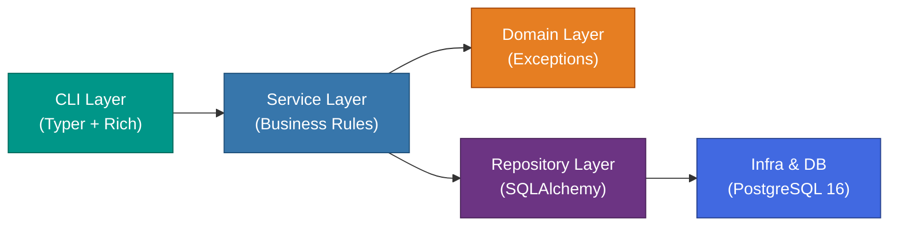

<div align="center">

# 📦 SmartStock CLI & DB

**Clean-Architecture Inventory Management System backed by PostgreSQL**  
*Project 01 of the **OmniChain Full-Stack Roadmap***

<p>
  
  
  
  
  
  
</p>

</div>

---

## ✨ Highlights

- **Strict Layered Architecture:** Clean separation between CLI, Service, Repository, Domain, and Infra.
- **Bulletproof Data Integrity:** Non-negative stock enforced at both the service layer and PostgreSQL (CheckConstraint).
- **Full Audit Trail:** Every stock change is recorded in stock_movements with cascade relations.
- **Versioned Migrations:** Schema evolution managed cleanly via Alembic.
- **Rich Terminal UX:** Color-coded tables and clear feedback powered by Typer & Rich.

---

## 🏗️ Architecture Flow



---

## 🧰 Tech Stack

| Layer | Technology | Purpose |
| :--- | :--- | :--- |
| **Core** | Python 3.12+ | Application runtime |
| **Database** | PostgreSQL 16 (Docker) | Persistent relational storage |
| **ORM & Migrations** | SQLAlchemy 2.x, Alembic, psycopg | Models, sessions, and schema versioning |
| **Interface** | Typer & Rich | Interactive, colorized CLI |
| **Quality & Testing** | Pytest, Ruff, Black, Mypy | Automated tests, linting, formatting, typing |

---

## 🚀 Quick Start

```bash
cp .env.example .env
docker compose up -d
alembic upgrade head
pytest
```

---

## 💻 CLI Commands

| Action | Command |
| :--- | :--- |
| **Add Product** | `python -m smartstock add --sku MAC-001 --name "MacBook Pro" --qty 10` |
| **Adjust Stock** | `python -m smartstock adjust --sku MAC-001 --delta -2 --reason "customer order"` |
| **List Inventory** | `python -m smartstock list` |
| **View History** | `python -m smartstock show --sku MAC-001` |
