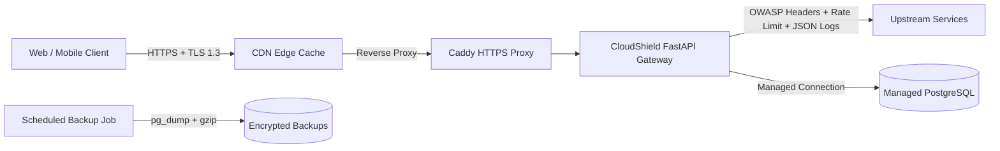

# 05-CloudShield-Production-Gateway

Production security gateway, cloud deployment blueprints, and operational tooling for the **OmniChain FullStack Roadmap (Module 05)**.

## Architecture Diagram

## Security & Cloud Highlights
- **OWASP Top 10 Hardening:** Enforces `HSTS`, `CSP`, `X-Content-Type-Options: nosniff`, `X-Frame-Options: DENY`, `Referrer-Policy`, and `Permissions-Policy`.
- **Rate Limiting:** Per-client sliding-window limiter with `X-RateLimit-Limit`, `X-RateLimit-Remaining`, and `429 Too Many Requests` (`Retry-After`).
- **Secrets Management:** Strict environment-only secret loading; production startup fails fast if `API_SECRET_KEY` is weak or default.
- **Cloud Deployment & Backups:** Ready-to-deploy `infra/render.yaml` (with Managed PostgreSQL), `infra/railway.json`, `infra/Caddyfile` (auto-HTTPS), and `scripts/backup_db.sh` (7-day retention).
- **ADR:** [ADR 0002: Cloud Security Hardening, Rate Limiting & Secrets Strategy](./docs/adr/0002-cloud-security-and-rate-limiting.md)

## Quick Start

    docker compose up --build

- **Gateway Health:** `http://localhost:8002/health`
- **CDN-Cacheable Endpoint:** `http://localhost:8002/api/v1/public/catalog`

## Portfolio Checklist
- [x] English `README.md` with Mermaid architecture diagram
- [x] Automated CI pipeline (`ruff`, `pytest`, script syntax check, Docker build)
- [ ] Record 2-minute demo video (healthcheck, `429` rate limit trigger, `X-Cache` & OWASP headers)
- [ ] Pin `OmniChain-FullStack-Roadmap` on GitHub profile
