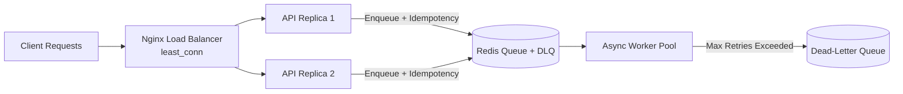

# 06-AsyncQueue-LoadBalancer-Messenger

High-throughput asynchronous messaging queue, retry/DLQ worker pool, and load-balanced API cluster for the **OmniChain FullStack Roadmap (Module 06)**.

## Architecture Diagram

## Highlights
- **Idempotent Producer API:** Deduplicates requests via `Idempotency-Key` (`X-Idempotent-Replay: true | false`).
- **Fault-Tolerant Worker & DLQ:** Automatic retry tracking, Dead-Letter Queue isolation, and `POST /api/v1/dlq/replay`.
- **Horizontal Load Balancing:** Nginx `least_conn` routing across `api-1` and `api-2` with `X-Upstream-Instance` traceability.
- **ADR:** [ADR 0003: Async Queue, DLQ & Load Balancing](./docs/adr/0003-async-queue-dlq-and-load-balancing.md)

## Quick Start

    docker compose up --build

- **Load Balancer Endpoint:** `http://localhost:8083/health`
