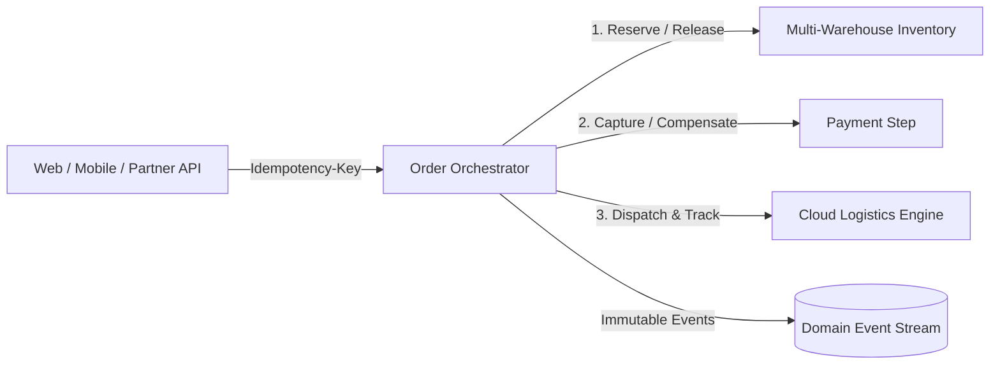

# 07-OmniChain-Enterprise-Core

Full-Stack Enterprise Commerce & Cloud Logistics Core for the **OmniChain FullStack Roadmap (Module 07)**.

## Architecture Diagram

## Enterprise Highlights
- **Multi-Warehouse Inventory:** Region-aware atomic stock reservation (`WH-EU-1`, `WH-US-1`) with automatic compensating release.
- **Cloud Logistics Engine:** Carrier routing (`DHL-Express-EU`, `FedEx-Global-Air`), tracking code generation, and validated shipment lifecycle (`DISPATCHED -> IN_TRANSIT -> DELIVERED`).
- **Saga-Ready Order Orchestrator:** Idempotent checkout with automatic inventory rollback (`COMPENSATED`) on payment failure.
- **Immutable Domain Event Log:** Captures `OrderCreated`, `InventoryReserved`, `PaymentCaptured`, `ShipmentDispatched`, and `OrderCompensated`.
- **ADR:** [ADR 0004: Event-Driven Commerce & Cloud Logistics Orchestration](./docs/adr/0004-enterprise-commerce-logistics-orchestration.md)

## Quick Start

    docker compose up --build

- **Enterprise Core Health:** `http://localhost:8004/health`
