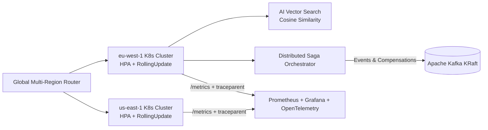

# 08-Hyperscale-Enterprise-Platform

Hyperscale Enterprise Layer for the **OmniChain FullStack Roadmap (Module 08)** — combining AI Vector Search, Distributed Saga Pattern, Apache Kafka, Kubernetes HPA, Prometheus/Grafana/OpenTelemetry, and Multi-Region Zero-Downtime architecture.

## Architecture Diagram

## Hyperscale Pillars
- **AI Vector Search:** Cosine-similarity semantic search API (`/api/v1/search/semantic` & `/api/v1/search/index`).
- **Distributed Saga Pattern:** Forward execution with automatic reverse compensation and Kafka-ready event envelopes (`/api/v1/sagas/orders`).
- **Full-Stack Observability:** Prometheus `/metrics`, W3C `traceparent` distributed tracing, plus Prometheus, Grafana, and OTel Collector configs.
- **Kubernetes & Multi-Region Zero-Downtime:** Kustomize base + `eu-west-1`/`us-east-1` overlays with `maxUnavailable: 0`, `HorizontalPodAutoscaler` (3–20 replicas), and `PodDisruptionBudget`.
- **ADR:** [ADR 0005: Hyperscale Architecture](./docs/adr/0005-hyperscale-kafka-saga-vector-k8s-multiregion.md)

## Quick Start

    docker compose up --build

- **EU Region API:** `http://localhost:8005/health` | **US Region API:** `http://localhost:8006/health`
- **Prometheus:** `http://localhost:9090` | **Grafana:** `http://localhost:3001`
