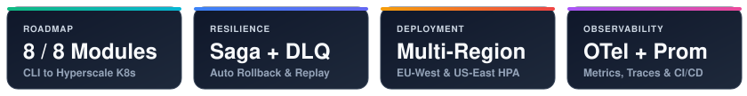
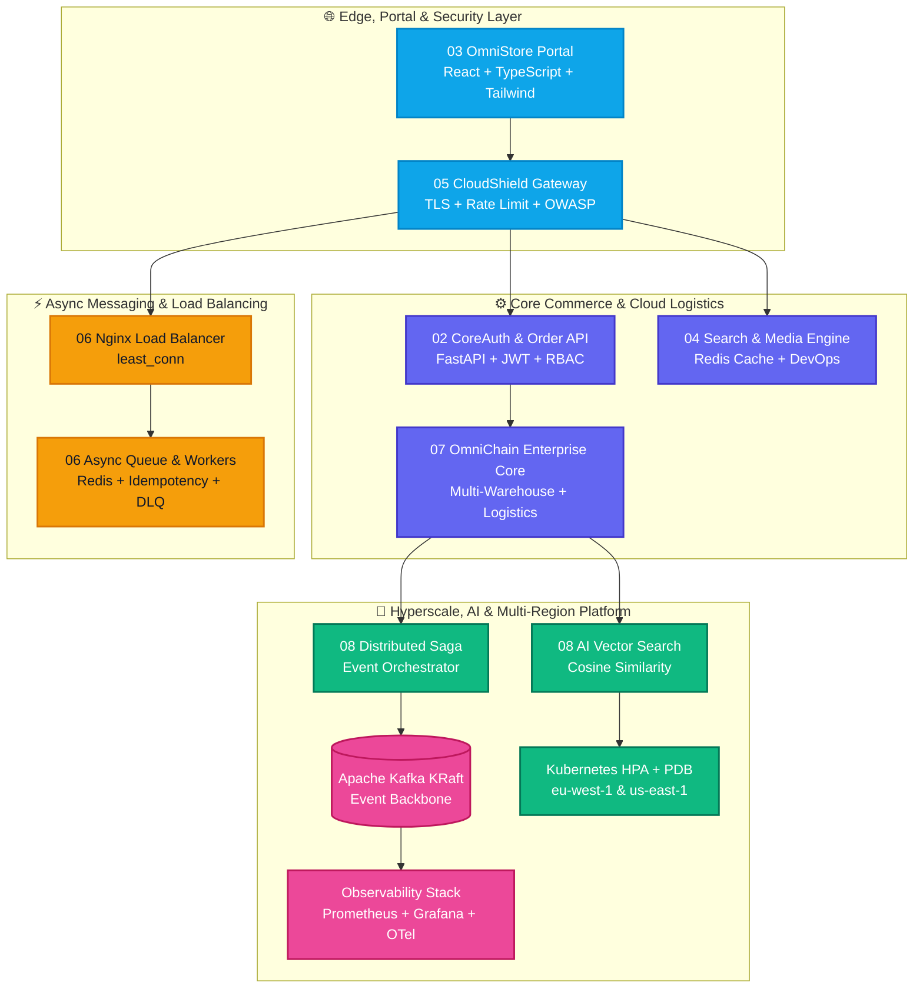
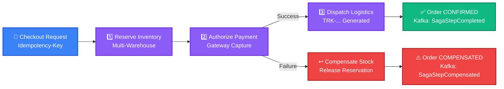

<div align="center">
  

  <h1>⚡ OmniChain — Full-Stack &amp; Hyperscale Enterprise Roadmap</h1>
  <p>
    <strong>From ACID inventory engines to Multi-Region Kubernetes, Apache Kafka, AI Vector Search, and Distributed Sagas — built as 8 progressive, production-tested modules.</strong>
  </p>

  <p>
    
  </p>

  <p>
    <a href="#-system-architecture">Architecture</a> •
    <a href="#-distributed-saga--compensation-flow">Saga Flow</a> •
    <a href="#-roadmap-modules-0108">Modules (01–08)</a> •
    <a href="#-tech-stack">Tech Stack</a> •
    <a href="#-quick-start">Quick Start</a> •
    <a href="#-architecture-decision-records-adrs">ADRs</a>
  </p>

  <br/>
  
</div>

---

## 🏗️ System Architecture



---

## 🔄 Distributed Saga & Compensation Flow



---

## 📦 Roadmap Modules (01–08)

| # | Module | Key Engineering Capabilities | Stack | Status |
| :---: | :--- | :--- | :--- | :---: |
| **01** | [`01-SmartStock-CLI-DB`](./01-SmartStock-CLI-DB) | ACID inventory engine, relational schema, CLI workflows | Python, PostgreSQL/SQLite, Pytest | ✅ |
| **02** | [`02-CoreAuth-Order-API`](./02-CoreAuth-Order-API) | JWT authentication, RBAC guards, order lifecycle API | FastAPI, JWT, Pydantic | ✅ |
| **03** | [`03-OmniStore-Frontend-Portal`](./03-OmniStore-Frontend-Portal) | Storefront & admin dashboard, responsive UI | React, TypeScript, Tailwind CSS | ✅ |
| **04** | [`04-SearchMedia-DevOps-Engine`](./04-SearchMedia-DevOps-Engine) | Search & media service, Redis caching, CI/CD | FastAPI, Redis, Docker | ✅ |
| **05** | [`05-CloudShield-Production-Gateway`](./05-CloudShield-Production-Gateway) | Reverse proxy, HTTPS/TLS, rate limiting, OWASP headers | Nginx, TLS, Security | ✅ |
| **06** | [`06-AsyncQueue-LoadBalancer-Messenger`](./06-AsyncQueue-LoadBalancer-Messenger) | Idempotent producer, async worker retries, DLQ replay, LB | Redis, Nginx `least_conn`, FastAPI | ✅ |
| **07** | [`07-OmniChain-Enterprise-Core`](./07-OmniChain-Enterprise-Core) | Multi-warehouse stock, carrier routing, Saga-ready rollback | FastAPI, Event Bus, PostgreSQL | ✅ |
| **08** | [`08-Hyperscale-Enterprise-Platform`](./08-Hyperscale-Enterprise-Platform) | AI Vector Search, Distributed Saga, Kafka, K8s HPA, OTel | Kafka, K8s, Prometheus, Grafana | ✅ |

---

## 🛠️ Tech Stack

<div align="center">
  
</div>

---

## 🚀 Quick Start

<details>
<summary><strong>⚡ Launch Module 06 — Async Queue, DLQ &amp; Nginx Load Balancer</strong></summary>

```bash
cd 06-AsyncQueue-LoadBalancer-Messenger
docker compose up --build
# Load Balancer Health: http://localhost:8083/health
```
</details>

<details>
<summary><strong>🏢 Launch Module 07 — Enterprise Commerce &amp; Cloud Logistics Core</strong></summary>

```bash
cd 07-OmniChain-Enterprise-Core
docker compose up --build
# Enterprise Core Health: http://localhost:8004/health
```
</details>

<details>
<summary><strong>🌐 Launch Module 08 — Hyperscale AI Vector Search, Saga, Kafka &amp; Observability</strong></summary>

```bash
cd 08-Hyperscale-Enterprise-Platform
docker compose up --build
# EU Region: http://localhost:8005/health | US Region: http://localhost:8006/health
# Prometheus: http://localhost:9090 | Grafana: http://localhost:3001
```
</details>

---

## 📐 Architecture Decision Records (ADRs)

- [**ADR 0003** — Async Queue, Dead-Letter Queue & Load Balancing](./06-AsyncQueue-LoadBalancer-Messenger/docs/adr/0003-async-queue-dlq-and-load-balancing.md)
- [**ADR 0004** — Event-Driven Commerce & Cloud Logistics Orchestration](./07-OmniChain-Enterprise-Core/docs/adr/0004-enterprise-commerce-logistics-orchestration.md)
- [**ADR 0005** — Hyperscale Architecture: Kafka, AI Vector Search, Saga, K8s HPA & Multi-Region](./08-Hyperscale-Enterprise-Platform/docs/adr/0005-hyperscale-kafka-saga-vector-k8s-multiregion.md)

---

<div align="center">
  <sub>Crafted for the <strong>OmniChain FullStack &amp; Hyperscale Roadmap</strong> • Release <code>v2.0.0</code></sub>
</div>
