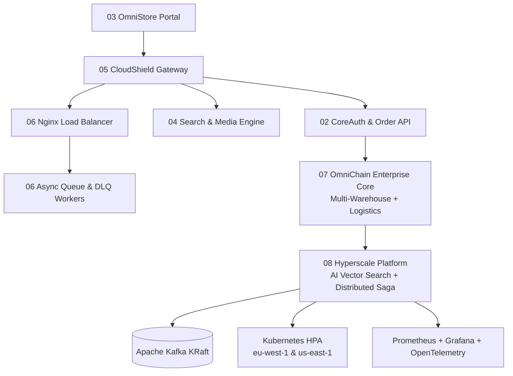

  

  

    
    
    
    
  

## Complete Roadmap Overview (Modules 01–08)

| # | Module | Core Stack & Engineering Highlights | Status |
|---|---|---|---|
| **01** | [`01-SmartStock-CLI-DB`](./01-SmartStock-CLI-DB) | Python CLI, PostgreSQL/SQLite, ACID Inventory Engine, Automated Tests | ✅ Completed |
| **02** | [`02-CoreAuth-Order-API`](./02-CoreAuth-Order-API) | FastAPI, JWT Authentication, RBAC, Order API, Pytest Suite | ✅ Completed |
| **03** | [`03-OmniStore-Frontend-Portal`](./03-OmniStore-Frontend-Portal) | React, TypeScript, Tailwind CSS, Admin & Storefront Portal | ✅ Completed |
| **04** | [`04-SearchMedia-DevOps-Engine`](./04-SearchMedia-DevOps-Engine) | Search & Media Engine, Redis Caching, Docker, CI/CD Pipeline | ✅ Completed |
| **05** | [`05-CloudShield-Production-Gateway`](./05-CloudShield-Production-Gateway) | Security Gateway, HTTPS/TLS, Rate Limiting, OWASP Hardening | ✅ Completed |
| **06** | [`06-AsyncQueue-LoadBalancer-Messenger`](./06-AsyncQueue-LoadBalancer-Messenger) | Redis Async Queue, Idempotency, Worker Retries & DLQ, Nginx `least_conn` LB | ✅ Completed |
| **07** | [`07-OmniChain-Enterprise-Core`](./07-OmniChain-Enterprise-Core) | Multi-Warehouse Inventory, Cloud Logistics, Saga-Ready Orchestrator & Rollback | ✅ Completed |
| **08** | [`08-Hyperscale-Enterprise-Platform`](./08-Hyperscale-Enterprise-Platform) | AI Vector Search, Distributed Saga, Kafka, K8s HPA, Prometheus/Grafana/OTel, Multi-Region | ✅ Completed |

## End-to-End Platform Architecture

## Architecture Decision Records (ADRs)
- [ADR 0003: Async Queue, DLQ & Load Balancing](./06-AsyncQueue-LoadBalancer-Messenger/docs/adr/0003-async-queue-dlq-and-load-balancing.md)
- [ADR 0004: Event-Driven Commerce & Cloud Logistics Orchestration](./07-OmniChain-Enterprise-Core/docs/adr/0004-enterprise-commerce-logistics-orchestration.md)
- [ADR 0005: Hyperscale Architecture — Kafka, AI Vector Search, Saga, K8s HPA & Multi-Region](./08-Hyperscale-Enterprise-Platform/docs/adr/0005-hyperscale-kafka-saga-vector-k8s-multiregion.md)
